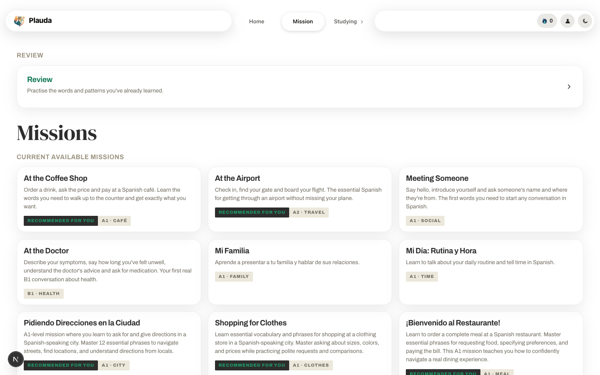
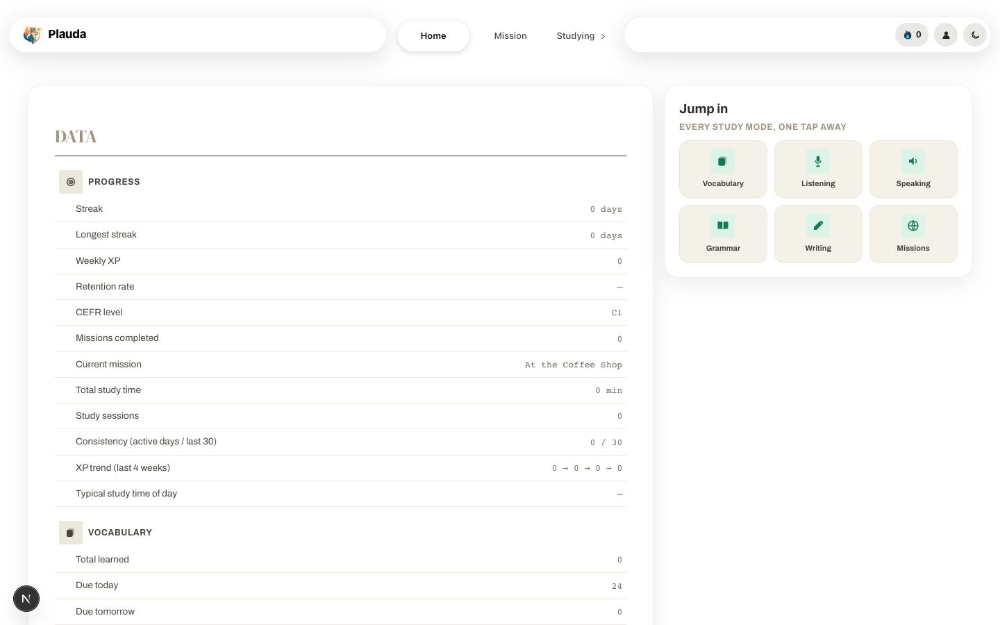
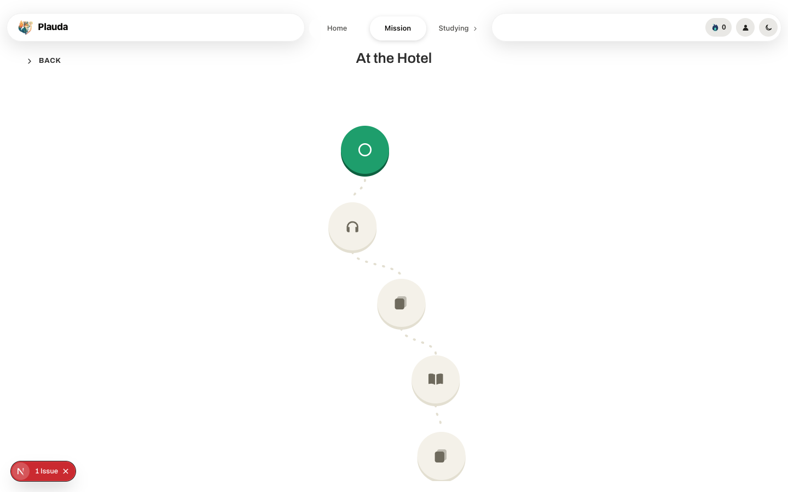
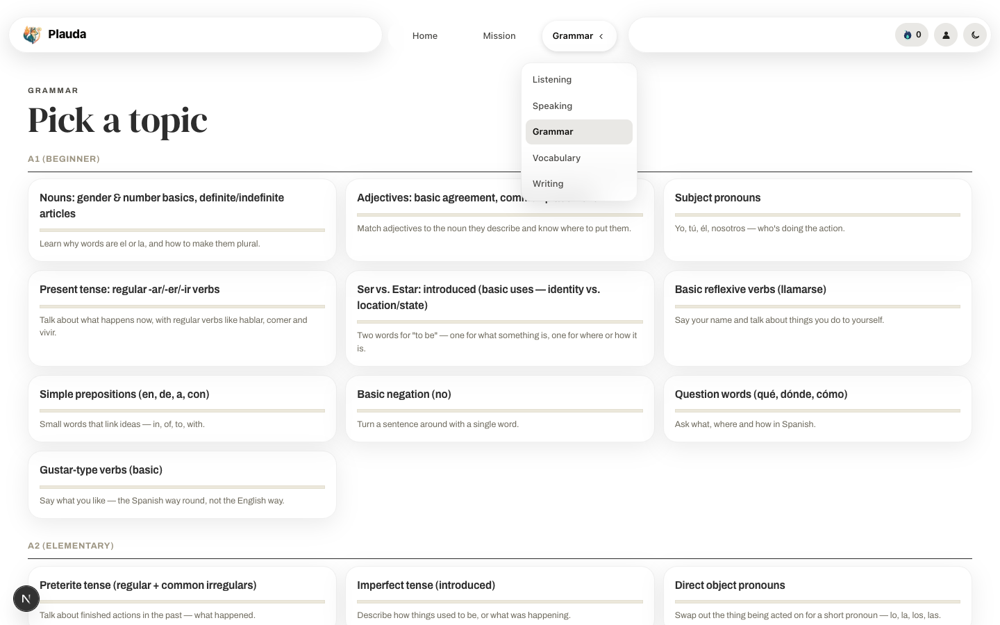
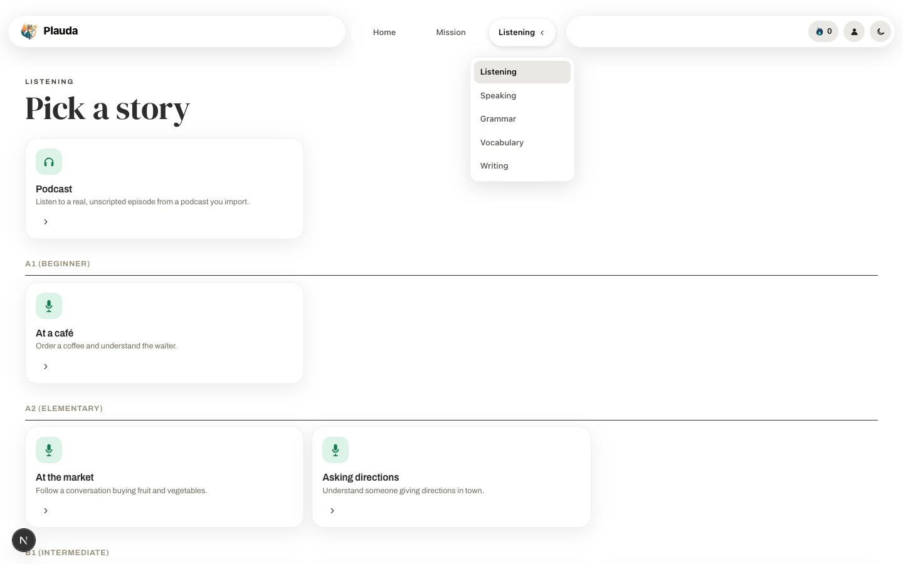
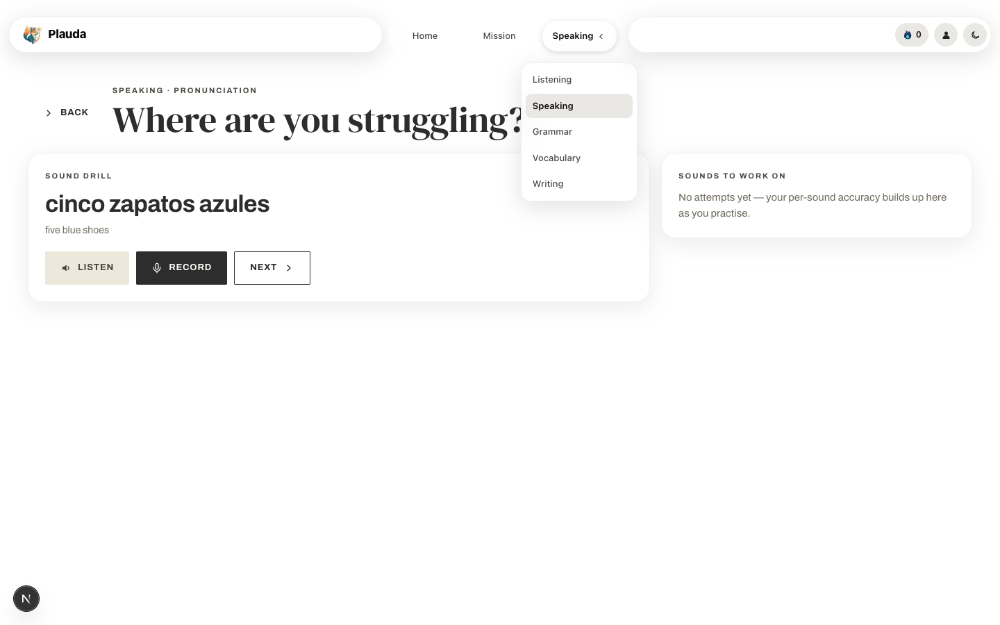

# Plauda

**Learn Spanish by living through real situations.** Plauda (developed under the working name *SpanishUp*) is a full-stack language-learning app. Every unit is a *mission*, such as ordering coffee, checking into a hotel or negotiating a contract. Inside a mission you listen, learn the words, practise the grammar, talk to an AI character, write, and finish with an unscripted conversation. Spaced repetition (FSRS-4.5) brings the words and grammar back at the right time.

> **Project status: archived.** Development has finished and the repository is kept as a portfolio piece. The app is complete and runs locally with one command, but no hosted version is maintained. Issues and PRs are not monitored.



| | |
|---|---|
|  |  |
|  |  |
|  | |

## Features

**Missions (the core loop)**
- 30 scenario missions, A1 to B2 (café, airport, doctor, pharmacy, hotel, job interview, banking, debates, hypotheticals…), each with 12 target words, 3 grammar patterns and an AI speaking scene.
- Each mission is a ladder: *Context Preview → Listening → Vocabulary I → Grammar → Vocabulary II → Speaking → Writing → Feedback → Vocabulary Recap → Final Challenge*. The learner's onboarding skill priority moves their preferred step to the front.
- When a mission is first opened, an LLM pipeline fills in its vocabulary (chunks, synonyms, gender, IPA, example sentences), a 7-stage speaking script and a context preview. Mistral is tried first and Claude Haiku is the fallback. The results are cached in Postgres.
- Missions are recommended from the learner's ranked goals (travel, work, academic…).

**Skills**
- **Vocabulary**: a 5-level trainer (recognition → picture + scrambled letters → recall → cloze → free sentence graded by AI), scheduled with FSRS.
- **Grammar**: a 44-topic syllabus from A1 to C1. Every topic is a 7-stage lesson: notice, rule, structured input, controlled practice, mixed practice, AI-graded free production, and spaced review on days 1/3/7/14.
- **Listening**: checkpointed narrative stories (A1 to C1, including a 10-minute two-voice B1 story) that pause to ask comprehension questions. There is also a **podcast player**: import a YouTube playlist, episodes download in the background, transcribe on demand with faster-whisper, follow along in a timestamped transcript, and tap any word to translate it and save it to your deck.
- **Speaking**: free AI conversation with scenario goals, streamed token by token over SSE, with optional ElevenLabs voice. **Pronunciation practice** scores each word through the Web Speech API and keeps a per-sound record (rr, j, ñ, ll, z/c…) that steers which drills come up next.
- **Writing**: guided writing lessons and an AI writing coach.
- **Dashboard**: streaks, XP trend, retention rate, consistency, study time of day, per-skill accuracy, weakest grammar structure, problem sounds and more.

## Architecture

```
Browser ──► Next.js 15 (App Router, :3000) ──/api/* rewrite──► FastAPI (:8000) ──► PostgreSQL
                                                                  │  ├─► Redis (dashboard cache)
                                                                  │  ├─► APScheduler + thread pool (yt-dlp downloads, faster-whisper)
                                                                  │  └─► Mistral / Claude / DeepL / Pexels / ElevenLabs (all optional)
```

- **Same-origin API.** The browser only ever calls `/api/*` on the frontend. Next.js rewrites those requests to the backend over the internal Docker network.
- **Auth.** A JWT in an httpOnly `access_token` cookie. Server components forward the cookie to `/auth/me`.
- **Backend layering.** `routers/` (HTTP) → `services/` (logic) → `models/` (SQLAlchemy 2.0), with Pydantic `schemas/` and hand-written Alembic migrations (head: `0028`).
- **Content as code.** Missions and listening stories are version-controlled JSON (`backend/content/`) and are upserted on every boot by `seed.py`. The frontend lesson decks live in `frontend/src/content/`.
- **Spaced repetition.** FSRS-4.5 is ported to Python (`services/srs.py`), and the same scheduler is used for vocabulary cards and grammar patterns.

| Layer | Tech |
|---|---|
| Frontend | Next.js 15, React 19, TypeScript, Tailwind + hand-rolled CSS, react-three-fiber (mission globe) |
| Backend | FastAPI, SQLAlchemy 2, Alembic, Pydantic v2, APScheduler |
| Data | PostgreSQL 16, Redis 7 |
| AI / media | Mistral Small, Claude Haiku, DeepL, Pexels, ElevenLabs, faster-whisper, yt-dlp |
| Tooling | Docker Compose, uv, ruff, mypy, ESLint, GitHub Actions |

## Getting started

Requirements: Docker with Compose v2.

```bash
git clone https://github.com/JonaszWD/Language-web-app.git
cd Language-web-app
cp .env.example .env      # works as-is for local use
make dev                  # builds and starts db, redis, backend, frontend
```

Open <http://localhost:3000> and create an account. The onboarding flow includes a short placement test. On boot the backend runs `alembic upgrade head` and `python seed.py`, so a fresh clone needs no extra steps.

### API keys (all optional)

The app runs without any keys. Each key turns on one group of features:

| Variable | Enables |
|---|---|
| `MISTRAL_API_KEY` | Mission enrichment, AI grading of sentences and grammar production, speaking turns (primary provider) |
| `CLAUDE_API_KEY` | Fallback for everything above (Claude Haiku) |
| `DEEPL_API_KEY` | Tap-to-translate in podcast transcripts and word glosses |
| `PEXELS_API_KEY` | Pictures for level-2 vocabulary exercises |
| `ELEVENLABS_API_KEY` | Natural NPC voices and two-voice long-form stories (the browser's TTS is used otherwise) |

## Development

```bash
make dev       # full stack with hot reload (backend: uvicorn --reload, frontend: next dev)
make migrate   # alembic upgrade head
make seed      # re-upsert missions + listening stories from backend/content/
make logs      # tail every service
make stop      # docker compose down
make clean     # down + drop volumes (wipes the database and downloaded audio)
```

Checks (the same ones CI runs on every push):

```bash
cd backend  && uv sync --dev && uv run ruff check . && uv run mypy app/
cd frontend && npm install && npm run lint && npx tsc --noEmit
```

New migration: `docker compose exec backend alembic revision -m "message"`, then edit the file under `backend/alembic/versions/`. Migrations are written by hand, without autogenerate.

### Authoring content

New missions and listening stories are generated offline and committed as JSON:

```bash
# inside the backend container; needs MISTRAL_API_KEY or CLAUDE_API_KEY
python scripts/generate_mission.py --scenario "At the pharmacy" --level A2
python scripts/generate_mission.py --story --scenario "Losing your passport" --level B1
python scripts/generate_mission.py --check m029-pharmacy   # offline vocabulary-budget lint
```

The generator only uses vocabulary taught by earlier missions plus the new mission's own words, and `--check` reports any word that falls outside that budget.

## Project structure

```
backend/
  app/
    routers/      auth, missions, study, vocab, grammar, listening, speaking, writing,
                  podcasts, stats, goals, tts, words
    services/     srs (FSRS), missions, mission_gen, enrich (LLM), vocab, listening,
                  podcast (yt-dlp + whisper), skill_stats, translate, tts, ...
    models/       SQLAlchemy models (all imported in models/__init__.py)
    schemas/      Pydantic request/response models
  alembic/        hand-written migrations 0001–0028
  content/        missions/*.json, listening/*.json (seeded on boot)
  scripts/        generate_mission.py, seed_listening_items.py
frontend/
  src/app/        routes: (app)/home, missions, grammar, listening, speaking, vocabulary,
                  writing; login; register (5-screen onboarding); planet (globe demo)
  src/components/ screens/, lesson engines (Grammar/Listening/Writing/Speaking),
                  PodcastPlayer, PronunciationPractice, FreeChat, VocabTrainer
  src/content/    generated mission decks + A2–C1 grammar lessons
docker-compose.yml          local dev
docker-compose.prod.yml     self-hosted production (only :3000 published)
docker-compose.deploy.yml   prebuilt GHCR images (used by the manual CD workflow)
```

## Deployment

```bash
docker compose -f docker-compose.prod.yml up -d --build
```

Only the frontend is published (port 3000). It proxies `/api` to the backend, which runs with migrations and seeding on boot and **a single uvicorn worker**. One worker is required because the podcast scheduler and the download/transcription queue run in-process. Set `ENABLE_SCHEDULER=0` if you need more workers. The Whisper model cache and podcast audio are kept in named volumes.

The `CD` GitHub workflow is manual-only now. It builds images to GHCR and can roll them out to a host over SSH.

## Known limitations

- Pronunciation scoring uses the browser's speech recogniser, so it works in Chrome, Edge and Safari but not Firefox. It measures intelligibility, not phoneme-level accuracy.
- Per-sound pronunciation history and grammar-lesson progress are kept in `localStorage`, so they don't follow a learner across devices.
- The globe view's optional 3D city layer is switched off because the Kenney building models it uses are not bundled.
- There is no automated test suite. Quality checks are lint and type checks in CI, plus manual end-to-end runs.

## License

[MIT](LICENSE) © 2026 Jonasz
